# Sơ đồ phụ thuộc nhánh

Lấy từ `git merge-base --is-ancestor` và `git rev-list` ngày 11/11/2026. Lịch sử thẳng: mỗi nhánh chứa trọn nhánh trước.

```mermaid
flowchart LR
  M["main<br/>dc47e98<br/>Sprint 0.1<br/>migrations 001–003"] --> S["feature/sprint-1-mvp<br/>461a19a · +13<br/>migrations 004–007<br/>(không PR)"]
  S --> U1["UI-01 login<br/>738c2a0 · +3<br/>(chỉ local)"]
  U1 --> U2["UI-02 dashboard<br/>921d9f8 · +2<br/>(chỉ local)"]
  U2 --> U3["UI-03 documents<br/>30aaf53 · +4<br/>(không PR)"]
  U3 -->|PR #1| U4["UI-04<br/>5348aff · +5"]
  U4 -->|PR #2| U5["UI-05<br/>08e337e · +5"]
  U5 -->|PR #3| U5B["UI-05B<br/>a3c3b93 · +3"]
  U5B -->|PR #4| U6["UI-06<br/>e2bcaba · +2"]
  U6 -->|PR #5| U7["UI-07<br/>5a3af00 · +2"]
  U7 -->|PR #6| U8["UI-08<br/>6fabca0 · +2<br/>tag ui-08-approved"]
  U8 -->|PR #7| U9["UI-09<br/>47597a6 · +3"]
  U9 -.dry-run.-> I["integration/final-qa-dryrun<br/>a5b8ee8<br/>cây = 47597a6"]
```

## Phụ thuộc kỹ thuật giữa các phần

| Phần | Phụ thuộc vào | Lý do |
|---|---|---|
| Sprint 1 (`feature/sprint-1-mvp`) | `main` | Migration **004–007** (workflow phiên bản, sự cố, đào tạo, tiêu đề phiên bản). API kiểm tra sẵn sàng **bắt buộc revision `007`** (`app/main.py`) |
| UI-01, UI-02 | Sprint 1 | Login và dashboard dùng API Sprint 1; AppFrame UI-02 là khung chung của mọi màn sau |
| UI-03 | UI-02 | AppFrame; bản sửa CI drill (`30aaf53`) được merge xuôi tới mọi nhánh sau |
| UI-04 | UI-03 | Link từ thư viện nội quy; mô hình `parseSections` |
| UI-05 | UI-04 | Dùng lại model UI-04; thêm trường chỉ đọc `ContentView` và tìm không dấu (API) |
| UI-05B | UI-05 | Trạng thái thư viện (sessionStorage), `approver_name` (API chỉ đọc) |
| UI-06 | UI-05B | Helper bài viết, quay lại thư viện; module seed DEMO `seed_incident_guides` |
| UI-07 | UI-06 | Form dùng workflow phiên bản (Sprint 1); test cũ `smoke`/`sprint01` đổi selector |
| UI-08 | UI-07 | Đổi `learning.py` (DATA-39 chặn mở lượt mới sau khi đạt); test cũ `sprint01`/`sprint1` đổi selector |
| UI-09 | UI-08 | Hàng đợi duyệt dùng workflow; test cũ `smoke` đổi selector; DATA-39B ghi backlog |

**Hệ quả:** không thể merge riêng một UI ở giữa mà bỏ qua UI trước nó, vì thiếu commit và test cũ sẽ lệch selector. Phải hợp nhất **theo thứ tự trên** hoặc gộp nguyên đầu chuỗi (`feature/ui-approvals`).
